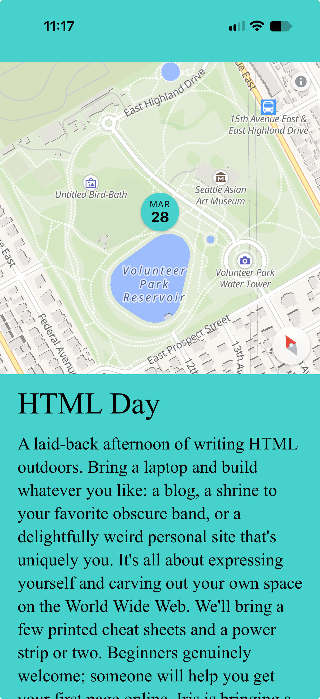

# /events 🐞

community-scale infrastructure for local meetups and workshops.  

<h3 align="center">
	
	 
	<a href="https://hunterirving.github.io/events">demo</a>  
</h3>

## features
- auto-generated printable flyers
- RSVP by E-mail
- installable as a [Progressive Web App](https://hunterirving.github.io/web_workshop/pages/pwa) for offline use

## usage
add an `events.json` file to `resources/` to override the events from `demo.json`.
- upcoming events will be displayed on the map.
- if no upcoming events are present, past events will be shown instead.

## license

this project is licensed under the <a href="LICENSE">GNU General Public License v3.0</a>.

the following third-party resources are included in this repo:

- **[MapLibre GL JS](https://maplibre.org)** 5.9.0, <a href="resources/maplibre/LICENSE-maplibre">BSD 3-Clause License</a>
- **[OSM Liberty](https://github.com/maputnik/osm-liberty)** basemap style, <a href="resources/basemap/LICENSE-osm-liberty">BSD 3-Clause License</a> (code) / [CC BY 3.0](https://creativecommons.org/licenses/by/3.0/) (design), vendored from [OpenFreeMap](https://github.com/hyperknot/openfreemap)'s fork (<a href="resources/basemap/LICENSE-openfreemap">MIT</a>)

map tiles are served by [OpenFreeMap](https://openfreemap.org) from [OpenStreetMap](https://www.openstreetmap.org/copyright) data.